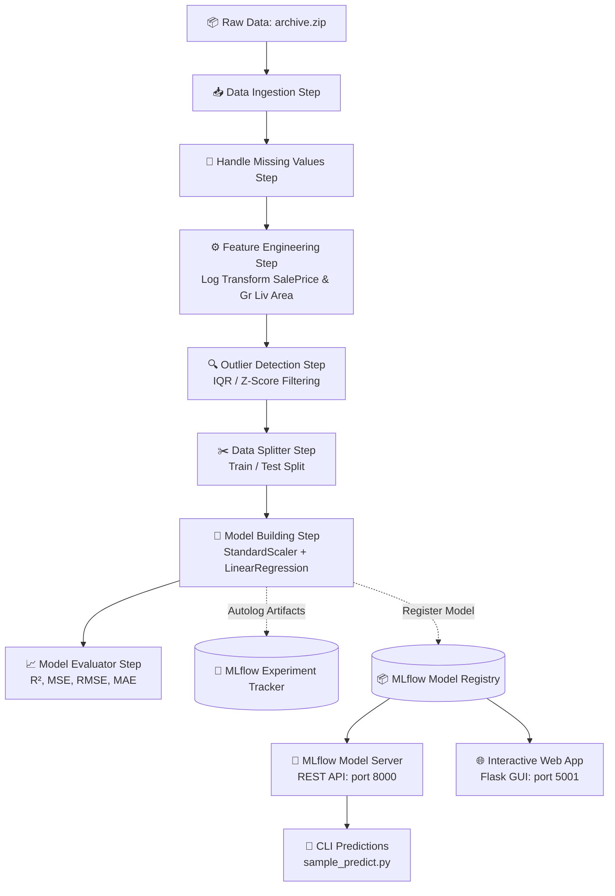

# 🏡 Ames House Price Prediction System
### *Production-Grade End-to-End MLOps Pipeline with ZenML, MLflow & Scikit-Learn*

<p align="center">
  
  
  
  
  
  
</p>

---

## 📌 Overview

The **Ames House Price Prediction System** is a robust, modular, and reproducible machine learning pipeline designed to predict residential real estate sale prices with high accuracy. 

Built using **ZenML** for pipeline orchestration and **MLflow** for experiment tracking and model registry, this project exemplifies production-grade MLOps practices:
- **SOLID Architectural Design**: Every data processing and modeling task is decoupled into interchangeable strategies using the **Strategy Design Pattern**.
- **Automated Experiment Tracking**: Parameters, metrics, model artifacts, and evaluation curves are versioned automatically in MLflow.
- **Continuous Deployment & Inference**: Integrated model serving capabilities with low-latency REST endpoints for real-time inference.

---

## 📊 Model Performance

Trained on the comprehensive Ames Housing dataset with robust outlier mitigation and log transformation:

| Metric | Score | Description |
|---|---|---|
| **R² Score** | **`0.922`** | Explains 92.2% of price variance |
| **Mean Squared Error (MSE)** | **`0.0109`** | Normalized log-scale error |
| **Pipeline Runtime** | **`~10–25s`** | Optimized with ZenML step caching |

---

## 🏗️ Architecture & Pipeline Flow



---

## 📂 Project Structure

```text
prices-predictor-system/
│
├── analysis/                     # Exploratory Data Analysis (EDA)
│   ├── analysis_src/             # Modular EDA scripts (univariate, bivariate, etc.)
│   └── EDA.ipynb                 # Interactive Jupyter notebook for data exploration
│
├── data/                         # Compressed source datasets
│   └── archive.zip               # Ames Housing raw dataset
│
├── extracted_data/               # Extracted CSV datasets
│   └── AmesHousing.csv
│
├── pipelines/                    # ZenML Pipeline Definitions
│   ├── training_pipeline.py      # End-to-end training pipeline
│   └── deployment_pipeline.py    # Continuous deployment & inference pipelines
│
├── src/                          # Core Logic (Strategy Pattern Implementations)
│   ├── data_splitter.py          # Train/test split algorithms
│   ├── feature_engineering.py    # Scaling & transformation strategies
│   ├── handle_missing_values.py  # Missing data imputation/drop strategies
│   ├── ingest_data.py            # Data extraction & loader strategies
│   ├── model_building.py         # Sklearn pipeline & estimator strategies
│   ├── model_evaluator.py        # Regression evaluation metrics
│   └── outlier_detection.py      # IQR & Z-score outlier detection strategies
│
├── steps/                        # ZenML Pipeline Step Wrappers
│   ├── data_ingestion_step.py
│   ├── handle_missing_values_step.py
│   ├── feature_engineering_step.py
│   ├── outlier_detection_step.py
│   ├── data_splitter_step.py
│   ├── model_building_step.py
│   ├── model_evaluator_step.py
│   ├── dynamic_importer.py
│   ├── prediction_service_loader.py
│   └── predictor.py
│
├── templates/                    # Web Application Frontend
│   └── index.html                # Modern glassmorphism UI for property valuations
│
├── app.py                        # Entrypoint: Interactive Flask Web App (port 5001)
├── run_pipeline.py               # Entrypoint: Execute the training pipeline
├── run_deployment.py             # Entrypoint: Execute deployment & batch inference
├── sample_predict.py             # Client script: Test REST API prediction endpoint
├── requirements.txt              # Project dependencies
└── README.md                     # Documentation
```

---

## 🧩 Software Design Principles

The core library under `src/` is built following the **Strategy Pattern** with Python's Abstract Base Classes (`abc.ABC`):

- **Encapsulated Behaviors**: Each data operation (e.g., imputation, transformation, outlier filtering) is an isolated class implementing a shared interface.
- **Extensible (Open/Closed Principle)**: Add new models (e.g., Random Forest, XGBoost, LightGBM) or scalers without changing a single line of pipeline execution logic.
- **ZenML Step Decoupling**: ZenML steps act as orchestrator adapters, keeping core domain logic pure and independent of the pipeline framework.

---

## 🚀 Getting Started

### 1. Environment Setup

Clone the repository and set up a clean Python virtual environment for your platform:

#### 🪟 Windows (PowerShell or Command Prompt)

```powershell
# Clone the repository
git clone https://github.com/Sovon410/house-price-mlops-pipeline.git
cd house-price-mlops-pipeline

# (Optional PowerShell) If script execution is restricted on your system:
Set-ExecutionPolicy -ExecutionPolicy RemoteSigned -Scope Process

# Create virtual environment
python -m venv .venv

# Activate virtual environment:
# In PowerShell:
.\.venv\Scripts\Activate.ps1
# In Command Prompt (cmd.exe):
# .\.venv\Scripts\activate.bat

# Upgrade pip & install dependencies
python -m pip install --upgrade pip
pip install -r requirements.txt
```

#### 🐧 Linux & 🍎 macOS (Bash or Zsh)

```bash
# Clone the repository
git clone https://github.com/Sovon410/house-price-mlops-pipeline.git
cd house-price-mlops-pipeline

# Create virtual environment
python3 -m venv .venv

# Activate virtual environment
source .venv/bin/activate

# Upgrade pip & install dependencies
python3 -m pip install --upgrade pip
pip install -r requirements.txt
```

---

### 2. Configure ZenML Stack

Initialize ZenML and register the MLflow experiment tracker and deployer stack:

#### 🪟 Windows (PowerShell / Command Prompt)

```powershell
# 1. Initialize ZenML repository
zenml init

# 2. Install MLflow integration
zenml integration install mlflow -y

# 3. Register components
zenml experiment-tracker register mlflow_tracker --flavor=mlflow
zenml model-deployer register mlflow_deployer --flavor=mlflow

# 4. Register and activate the stack (single-line command)
zenml stack register mlflow_stack -a default -o default -e mlflow_tracker -d mlflow_deployer
zenml stack set mlflow_stack

# 5. Verify stack configuration
zenml stack describe
```

#### 🐧 Linux & 🍎 macOS (Bash / Zsh)

```bash
# 1. Initialize ZenML repository
zenml init

# 2. Install MLflow integration
zenml integration install mlflow -y

# 3. Register components
zenml experiment-tracker register mlflow_tracker --flavor=mlflow
zenml model-deployer register mlflow_deployer --flavor=mlflow

# 4. Register and activate the stack
zenml stack register mlflow_stack \
    -a default \
    -o default \
    -e mlflow_tracker \
    -d mlflow_deployer

zenml stack set mlflow_stack

# 5. Verify stack configuration
zenml stack describe
```

---

## 🏃 Execution Guide

### Step 1: Run the Training Pipeline

Execute the end-to-end training pipeline (ingestion, cleaning, feature engineering, outlier removal, splitting, training, evaluation):

**🪟 Windows:**
```powershell
python .\run_pipeline.py
```

**🐧 Linux / 🍎 macOS:**
```bash
python3 run_pipeline.py
```

**Expected output:**
```text
Initiating a new run for the pipeline: ml_pipeline.
Executing a new run.
Using stack: mlflow_stack
✅ Step data_ingestion_step has finished.
✅ Step handle_missing_values_step has finished.
✅ Step feature_engineering_step has finished.
✅ Step outlier_detection_step has finished.
✅ Step data_splitter_step has finished.
✅ Step model_building_step has finished.
✅ Step model_evaluator_step has finished.
Pipeline run has finished in ~10.3s.

Evaluation Metrics:
- MSE: 0.0109
- R-Squared: 0.922
```

---

### Step 2: Open MLflow Experiment Tracking Dashboard

View logged metrics, hyper-parameters, and model artifacts:

**Cross-Platform (Standard):**
```bash
mlflow ui
```

**Specifying ZenML Local Store Backend URI:**
- **🪟 Windows:**
  ```powershell
  mlflow ui --backend-store-uri "file:C:\Users\$env:USERNAME\AppData\Roaming\zenml\local_stores\0217948e-b21e-4af3-a5b4-0d4abccd3a26\mlruns"
  ```
- **🐧 Linux / 🍎 macOS:**
  ```bash
  mlflow ui --backend-store-uri "file://$HOME/.config/zenml/local_stores/0217948e-b21e-4af3-a5b4-0d4abccd3a26/mlruns"
  ```

Open your browser and navigate to **`http://127.0.0.1:5000`**.

---

### Step 3: Deploy & Serve the Model

Launch the trained model as a local REST API serving predictions on port `8000`:

#### 🪟 Windows Users:
> ⚠️ **Windows Notice**: ZenML's daemon-based model deployer relies on Unix process forking, which is unsupported on Windows (`Daemon functionality is currently not supported on Windows`). Serving directly via MLflow uses the built-in multi-threaded Waitress WSGI server:

```powershell
# In your active terminal:
mlflow models serve -m "models:/prices_predictor/latest" -p 8000 --no-conda
```

#### 🐧 Linux & 🍎 macOS Users:
On Unix-like systems, you can use either ZenML's continuous deployment pipeline (daemonized) or direct MLflow serving:

```bash
# Option A: Full ZenML Continuous Deployment Pipeline
python3 run_deployment.py

# Option B: Direct MLflow Model Server
mlflow models serve -m "models:/prices_predictor/latest" -p 8000 --no-conda
```

When the server starts successfully, it will display:
```text
INFO:waitress:Serving on http://127.0.0.1:8000
```
*(Leave this terminal window open; the server runs in the foreground).*

> 💡 **Why does `http://127.0.0.1:8000` show `404 Not Found` in your browser?**  
> Port 8000 is a programmatic **REST API scoring endpoint**, not a website with an HTML home page. Opening `http://127.0.0.1:8000/` in a web browser will display `404 Not Found` because it only listens for **POST** requests at `/invocations` (or GET at `/ping`).  
> - For the **visual web dashboard**, use `mlflow ui` on **`http://127.0.0.1:5000`**.  
> - For **model predictions**, send POST requests to **`http://127.0.0.1:8000/invocations`** (via `sample_predict.py` or `curl`).

---

### 🌐 Ports & Services Summary

| Service | Port & URL | Description | How to Launch |
|---|---|---|---|
| **Interactive Web UI** | **`http://127.0.0.1:5001`** | Visual form in browser with live valuation card | `python app.py` |
| **MLflow Experiment Dashboard** | **`http://127.0.0.1:5000`** | Visual metrics ($R^2$, MSE), hyperparams, artifacts | `mlflow ui` |
| **Model REST Scoring Server** | **`http://127.0.0.1:8000/invocations`** | Machine-to-machine JSON prediction endpoint (POST only) | `mlflow models serve` |
| **ZenML Dashboard** | **`http://127.0.0.1:8237`** | Pipeline DAG runs & stack inspector | `zenml up` |

---

### Step 4: Run Inference & Predictions

You have three options for testing model predictions:

#### 🌟 Option 1: Live Interactive Web UI (Auto-Opens in Browser)

Launch the modern real estate prediction web app. **This single command starts the server and automatically pops open your default web browser** to the dashboard:

**🪟 Windows (PowerShell):**
```powershell
.\.venv\Scripts\Activate.ps1 ; python .\app.py
```

**🪟 Windows (Command Prompt):**
```cmd
.\.venv\Scripts\activate.bat && python app.py
```

**🐧 Linux & 🍎 macOS (Bash / Zsh):**
```bash
source .venv/bin/activate && python3 app.py
```

> 🚀 **Zero Configuration**: Running `python app.py` automatically launches Google Chrome / your default browser directly at **`http://127.0.0.1:5001`**. Simply customize the house attributes (or use the pre-filled defaults) and click **⚡ Calculate Valuation**!

---

#### 🧪 Option 2: Python Client Script (`sample_predict.py`)

With the MLflow server running on port 8000, open a second terminal:

```powershell
# Windows
.\.venv\Scripts\Activate.ps1
python .\sample_predict.py

# Linux & macOS
source .venv/bin/activate
python3 sample_predict.py
```

**Output:**
```json
Prediction: {'predictions': [280.4640878465722]}
```

---

#### ⚡ Option 3: Direct Terminal `curl` Request

**🪟 Windows PowerShell:**
```powershell
curl.exe -X POST http://127.0.0.1:8000/invocations `
  -H "Content-Type: application/json" `
  -d "{\"dataframe_records\": [{\"Order\": 1, \"PID\": 5286, \"MS SubClass\": 20, \"Lot Frontage\": 80.0, \"Lot Area\": 9600, \"Overall Qual\": 5, \"Overall Cond\": 7, \"Year Built\": 1961, \"Year Remod/Add\": 1961, \"Mas Vnr Area\": 0.0, \"BsmtFin SF 1\": 700.0, \"BsmtFin SF 2\": 0.0, \"Bsmt Unf SF\": 150.0, \"Total Bsmt SF\": 850.0, \"1st Flr SF\": 856, \"2nd Flr SF\": 854, \"Low Qual Fin SF\": 0, \"Gr Liv Area\": 1710.0, \"Bsmt Full Bath\": 1, \"Bsmt Half Bath\": 0, \"Full Bath\": 1, \"Half Bath\": 0, \"Bedroom AbvGr\": 3, \"Kitchen AbvGr\": 1, \"TotRms AbvGrd\": 7, \"Fireplaces\": 2, \"Garage Yr Blt\": 1961, \"Garage Cars\": 2, \"Garage Area\": 500.0, \"Wood Deck SF\": 210.0, \"Open Porch SF\": 0, \"Enclosed Porch\": 0, \"3Ssn Porch\": 0, \"Screen Porch\": 0, \"Pool Area\": 0, \"Misc Val\": 0, \"Mo Sold\": 5, \"Yr Sold\": 2010}]}"
```

**🐧 Linux & 🍎 macOS (Bash / Zsh):**
```bash
curl -X POST http://127.0.0.1:8000/invocations \
  -H "Content-Type: application/json" \
  -d '{"dataframe_records": [{"Order": 1, "PID": 5286, "MS SubClass": 20, "Lot Frontage": 80.0, "Lot Area": 9600, "Overall Qual": 5, "Overall Cond": 7, "Year Built": 1961, "Year Remod/Add": 1961, "Mas Vnr Area": 0.0, "BsmtFin SF 1": 700.0, "BsmtFin SF 2": 0.0, "Bsmt Unf SF": 150.0, "Total Bsmt SF": 850.0, "1st Flr SF": 856, "2nd Flr SF": 854, "Low Qual Fin SF": 0, "Gr Liv Area": 1710.0, "Bsmt Full Bath": 1, "Bsmt Half Bath": 0, "Full Bath": 1, "Half Bath": 0, "Bedroom AbvGr": 3, "Kitchen AbvGr": 1, "TotRms AbvGrd": 7, "Fireplaces": 2, "Garage Yr Blt": 1961, "Garage Cars": 2, "Garage Area": 500.0, "Wood Deck SF": 210.0, "Open Porch SF": 0, "Enclosed Porch": 0, "3Ssn Porch": 0, "Screen Porch": 0, "Pool Area": 0, "Misc Val": 0, "Mo Sold": 5, "Yr Sold": 2010}]}'
```

---

## 💻 Cross-Platform Command Cheat Sheet

| Task | 🪟 Windows (PowerShell / CMD) | 🐧 Linux & 🍎 macOS (Bash / Zsh) |
|---|---|---|
| **Create Virtualenv** | `python -m venv .venv` | `python3 -m venv .venv` |
| **Activate Virtualenv** | `.\.venv\Scripts\Activate.ps1` *(or `.bat`)* | `source .venv/bin/activate` |
| **Install Dependencies**| `pip install -r requirements.txt` | `pip install -r requirements.txt` |
| **Run Training Pipeline**| `python .\run_pipeline.py` | `python3 run_pipeline.py` |
| **Launch Web App (Port 5001)**| `python .\app.py` | `python3 app.py` |
| **Launch MLflow UI** | `mlflow ui` | `mlflow ui` |
| **Serve Model (Port 8000)**| `mlflow models serve -m "models:/prices_predictor/latest" -p 8000 --no-conda` | `mlflow models serve -m "models:/prices_predictor/latest" -p 8000 --no-conda` |
| **Run Sample Predict** | `python .\sample_predict.py` | `python3 sample_predict.py` |
| **Check Port 8000** | `netstat -ano \| findstr :8000` | `lsof -i :8000` *(or `netstat -tuln`)* |
| **Kill Port 8000** | `Stop-Process -Id (Get-NetTCPConnection -LocalPort 8000).OwningProcess -Force` | `kill -9 $(lsof -t -i:8000)` |
| **Launch EDA Notebook** | `jupyter notebook analysis\EDA.ipynb` | `jupyter notebook analysis/EDA.ipynb` |
| **ZenML Dashboard** | `zenml up` | `zenml up` |

---

## 📡 REST API Specification

### Endpoint: `/invocations`
- **Method**: `POST`
- **Headers**: `Content-Type: application/json`
- **URL**: `http://127.0.0.1:8000/invocations`

#### Sample Request Body:
```json
{
  "dataframe_records": [
    {
      "Order": 1,
      "PID": 5286,
      "MS SubClass": 20,
      "Lot Frontage": 80.0,
      "Lot Area": 9600,
      "Overall Qual": 5,
      "Overall Cond": 7,
      "Year Built": 1961,
      "Year Remod/Add": 1961,
      "Mas Vnr Area": 0.0,
      "BsmtFin SF 1": 700.0,
      "Total Bsmt SF": 850.0,
      "1st Flr SF": 856,
      "2nd Flr SF": 854,
      "Gr Liv Area": 1710.0,
      "Full Bath": 1,
      "Bedroom AbvGr": 3,
      "Kitchen AbvGr": 1,
      "TotRms AbvGrd": 7,
      "Garage Cars": 2,
      "Garage Area": 500.0,
      "Yr Sold": 2010
    }
  ]
}
```

---

## 🛠️ Technology Stack

| Component | Tool / Library | Role |
|---|---|---|
| **Language** | Python 3.10+ | Core development |
| **Pipeline Orchestration** | [ZenML](https://zenml.io/) | Declarative, reproducible pipelines & step caching |
| **Experiment Tracking** | [MLflow](https://mlflow.org/) | Run tracking, parameter logging & model registry |
| **Modeling & Preprocessing** | [Scikit-Learn](https://scikit-learn.org/) | Linear regression, pipelines & transformers |
| **Data Manipulation** | [Pandas](https://pandas.pydata.org/), [NumPy](https://numpy.org/) | DataFrames & numerical operations |
| **Visualization** | [Matplotlib](https://matplotlib.org/), [Seaborn](https://seaborn.pydata.org/) | Exploratory data analysis |
| **Serving Server** | Waitress (MLflow backend) | Production WSGI server for model serving |
| **Web Application** | [Flask](https://palletsprojects.com/p/flask/) | Interactive browser valuation interface |

---

## 🤝 Contributing

Contributions, issues, and feature requests are welcome!
1. Fork the Project
2. Create your Feature Branch (`git checkout -b feature/AmazingFeature`)
3. Commit your Changes (`git commit -m 'Add some AmazingFeature'`)
4. Push to the Branch (`git push origin feature/AmazingFeature`)
5. Open a Pull Request
